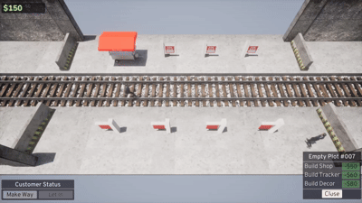
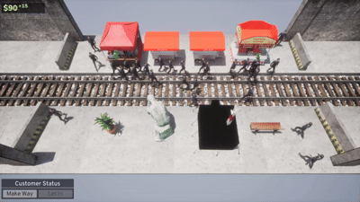
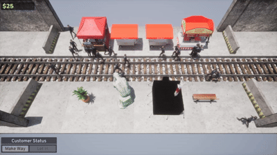
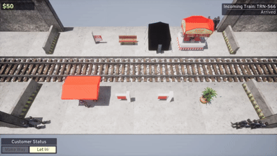
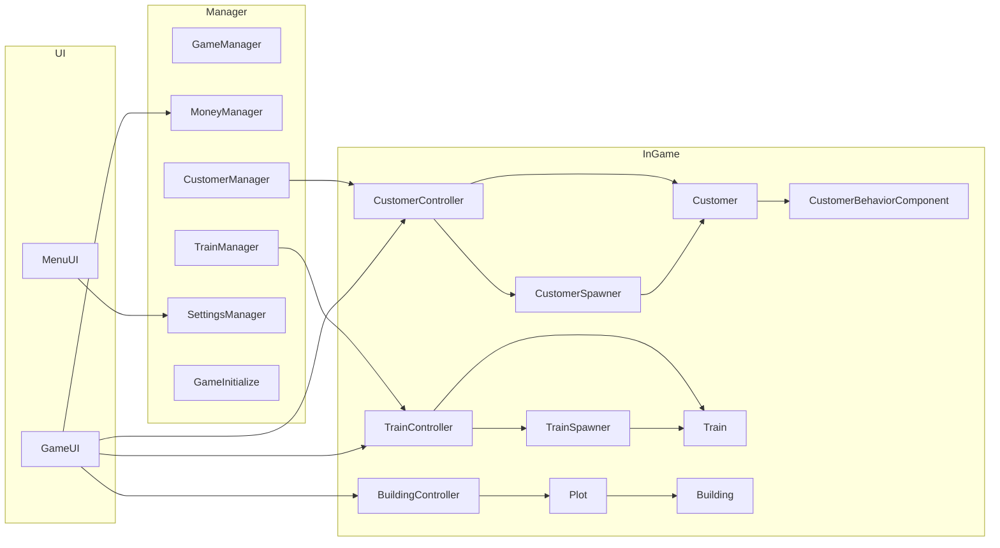
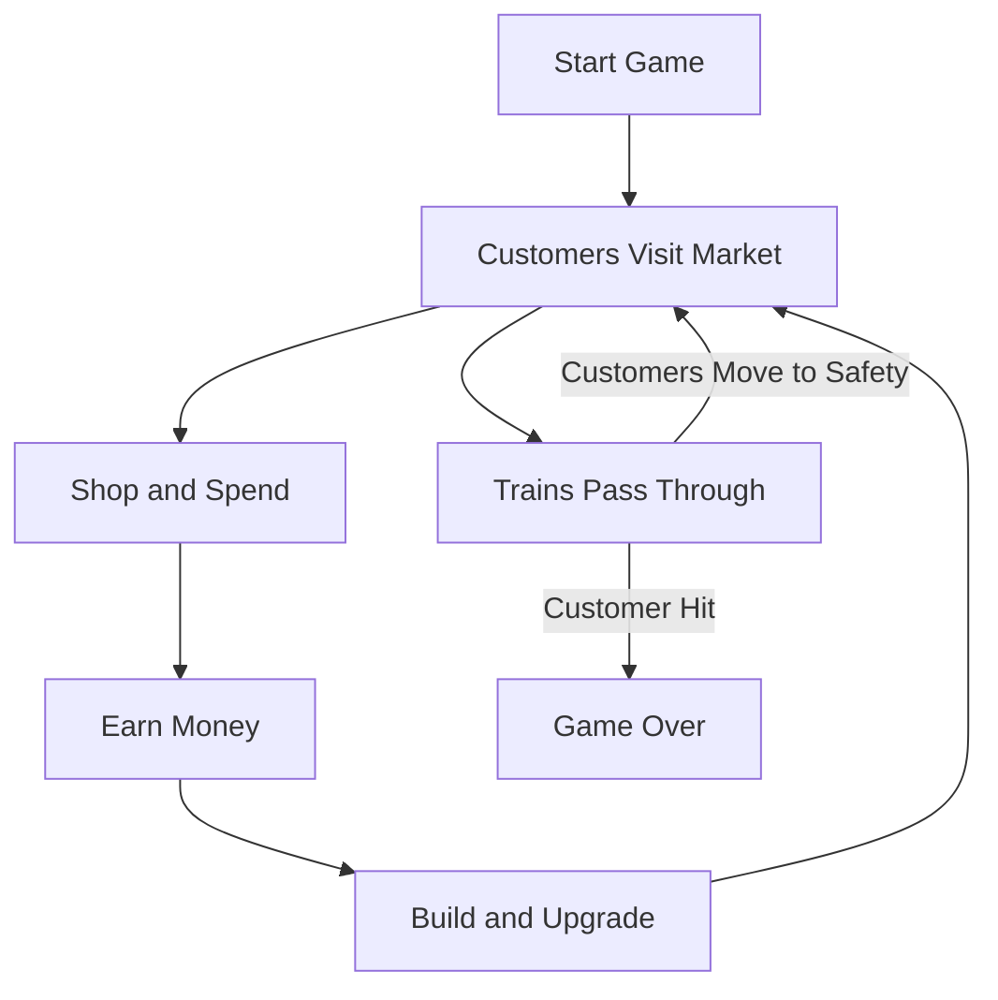

<h1 align="center">🚃 Train Market Simulator 🛍️</h1>

## Overview 🌐

<p align="justify">A game where you manage a market above railway tracks. The game is a mix of city building and management where you build shops and other buildings while preventing any customer from being hit by incoming trains.</p>

<table border="0" cellpadding="0" cellspacing="0" style="border: none; border-collapse: collapse;">
    <tr>
        <td width="50%" style="border: none;"></td>
        <td width="50%" style="border: none;"></td>
    </tr>
    <tr>
        <td width="50%" style="border: none;"></td>
        <td width="50%" style="border: none;"></td>
    </tr>
</table>

<p align="justify">This is my first Unreal project and was made by myself using free online assets.</p>

### Time spent: 40 Days 📅 / 240 Work Hours ⌛

## Key Features ✨

- Building economy loop with placement, upgrades, and demolition value decisions
- Train-based movement and station flow system with interval scaling and notifications
- Customer simulation with spawn timing, interest chance, and purchase behavior
- Progression and difficulty curve tied to game time and train traffic
- Money and resource management for gameplay progression and upgrades
- Pause, resume, lose-state, and restart flow for gameplay lifecycle management
- Settings system for audio volume, game options, and persistence

## Main Modules and Components 🧩

This project is primarily organized through these corresponding folder roots:
```text
GameGauntletSimJam/
├── Content/                # Game assets, Blueprints, maps, audio, and UI
└── Source/
    └── GameGauntletSimJam/
        ├── Building/       # Buildings, plots, and building controller
        ├── Common/         # Shared components, initialization, and managers
        ├── Customer/       # Customer actors, behavior, and spawning
        ├── Progression/    # Difficulty and progression logic
        ├── Train/          # Train actors, controllers, and spawning
        └── UI/             # Game and menu UIs and view models
```



| Section | Component | Purpose |
|---|---|---|
| Core Systems | `Common/Manager/GameManager` | Manages game state flow, pause/resume, lose, and restart behaviour. |
| Core Systems | `Common/Manager/MoneyManager` | Tracks money, affordability checks, and money change events. |
| Core Systems | `Common/Manager/CustomerManager` | Controls customer spawn timing and interest increase logic. |
| Core Systems | `Common/Manager/TrainManager` | Handles track interval and train spawn balancing logic. |
| Core Systems | `Common/Manager/SettingsManager` | Manages volume settings, persistence, and audio application. |
| Core Systems | `Common/GameInitialize` | Initializes gameplay subsystems and starts the run state. |
| Gameplay | `Customer/Customer` | Customer actor with shopping, strolling, making-way, and purchase events. |
| Gameplay | `Customer/CustomerBehaviorComponent` | Drives customer behavior states, including strolling, shopping, and making way for trains. |
| Gameplay | `Customer/CustomerSpawner` | Spawns customers at intervals and sets them up for gameplay. |
| Gameplay | `Customer/CustomerController` | Handles customer lifecycle, purchases, and spawn updates. |
| Gameplay | `Train/Train` | Train actor that handles travel, track passing, and customer collision events. |
| Gameplay | `Train/TrainSpawner` | Spawns trains at intervals and sets them up for gameplay. |
| Gameplay | `Train/TrainController` | Manages train instances, notifications, route events, and arrivals. |
| Gameplay | `Building/` | Provides base building logic, upgrades, mesh switching, and demolition value. |
| Gameplay | `Building/Shop/Shop` | Handles shop interactions, customer purchases, and economy flow. |
| Gameplay | `Building/Tracker/Tracker` | Tracking structures that affect train intervals and spawn pacing. |
| Gameplay | `Building/Plot/Plot` | Space in the game for holding buildings. |
| Gameplay | `Building/Decor/Decor` | Decorative buildings that modify customer and spawn balance. |
| Gameplay | `Building/BuildingController` | Manages buildings through plots. |
| Gameplay | `Progression/ProgressionController` | Scales difficulty over time and tunes train progression. |
| UI | `UI/Game/` | In-game HUD and control panels for gameplay feedback. |
| UI | `UI/Menu/` | Main menu flow and menu state management. |
| UI | `UI/Component/BasicButton` | Reusable button UI component. |
| UI | `UI/ViewModel/` | View models for building, customer, settings, and train state. |
| UI | `UI/Parts/` | Modular UI panels and notification widgets. |

## Gameplay Flow 🎮



## Additional Info 📝
This game was submitted to Game Gauntlet - SIM Jam 2026.<br>
Game page: <a href="https://maximillian520.itch.io/train-market-simulator">itch.io</a>
